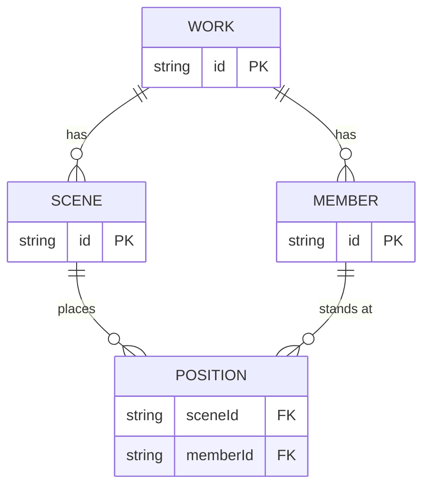

# フォーメーション帳 設計

## 結論

- スマホの指で「場面ごとの立ち位置」を置き、カウントに沿って場面の間をアニメーションで再生するアプリを作る。配るときは場面ごとに1ページの PDF を書き出す。
- GitHub Pages に置く（リポ `iiiitiiitiiti/formation`）。既存の自作アプリ（ひとつめ・がまんログ・かいもの）と同じ Vite＋React＋TypeScript＋vitest＋PWA の骨組みを使う。
- 作ったものは端末の中に保存し、PC へ持ち運ぶときはファイルに書き出して読み込む。

## 使う人と場面

- 使うのはユーザー本人（フラを18年習っている）。発表会などの立ち位置を考える。
- 作るのは主にスマホ。PC は見る・たまに直す程度だが、PC でも同じ操作ができる。
- 他の人には、リンクではなく PDF（画像）を LINE などで配る。

## 成功条件

1. スマホだけで次のことができる。人数・ステージの大きさ・区切りを決める。場面を足す。指で人を動かす。
2. 再生すると、カウントの速さで人が次の立ち位置へまっすぐ動く。今が何カウント目か分かる。
3. 「PDF で配る」を押すと、場面ごとに1ページの PDF ができ、スマホの共有メニューから LINE へ送れる。
4. 閉じて開き直しても作品が残る。書き出したファイルを PC で読み込むと同じ作品が開く。
5. Tab キーで画面の並び順どおりにフォーカスが回り、選んだ人を矢印キーで動かせる。

## ユーザーが決めたこと（2026-11-06）

| 論点 | 決定 |
|---|---|
| 見る人 | 他の人も見る。共有はリンクではなく画像か PDF |
| 区切り | マス目＋センターから番号（センター0、左右へ1・2・3…）。本数は変えられる |
| 曲との合わせ方 | カウントで進める。曲は使わない。速さはテンポで決める |
| 置き場所 | GitHub Pages |
| 作る端末 | スマホ |
| 配る形 | PDF で場面ごとに1ページ |
| 人の表し方 | 色つきの丸＋短い名前 |
| 場面の間の移動 | まっすぐ移動・動線（前の場面からの矢印）を表示 |

## データの形

保存先は端末のブラウザ（localStorage）。作品1件を1つの JSON にまとめて持つ。

- 作品（WORK）: 題名・ステージ（間口 m・奥行き m・センターから片側の区切り数・奥行きの区切り数）・1区切りのカウント数（8 か 4）・テンポ（BPM）・更新日時。
- 人（MEMBER）: 短い名前・色・並び順。
- 場面（SCENE）: 並び順・メモ・移動にかけるカウント数・止まっているカウント数。最初の場面の移動カウントは 0。
- 立ち位置（POSITION）: 場面×人ごとに x・y（メートル。x はセンター0、y は客席側の端が0）。場面と人の組ごとに必ず1つある。
  - 人を足すと全場面に立ち位置を作る（初期位置は下手の袖）。人を消すと全場面から消す。場面を足すと今の場面を写す。場面を消すとその場面の立ち位置も消す。この4つは単体テストに入れる。
- 保存する JSON には形式の版番号を入れ、古い版を読み込むときに直せるようにする。

座標をメートルで持つので、区切りの本数を変えても人の位置は変わらない。ステージの外（左右の袖）にも置けるようにして、出はけはこれで表す。

区切りの番号は縦の線に付ける。センターの線が0で、左右へ1・2・3…。「センターから片側の区切り数」は片側の線の数。奥行きは線だけで番号は付けない。吸い付きの刻みは線の間隔の半分。

### 保存が消える条件（iPhone）

iPhone の Safari は、ホーム画面に追加していないサイトの保存内容を、7日間開かないと消すことがある。対策は3つ。

1. 初めて開いたとき「ホーム画面に追加」を案内する（追加済みなら出さない）。
2. 作品一覧に「最後にファイルへ書き出した日」を出す。書き出していない作品が7日以上前の更新なら、書き出しを促す。
3. 保存の持続をブラウザに頼む（navigator.storage.persist）。

## 画面

1. **作品の一覧**: 作品を開く・新しく作る・複製・消す（消したら数秒「元に戻す」を出す）。ファイルに書き出す・読み込むもここ。
2. **作品の編集**（主な画面。スマホ縦向き）
   - 上: ステージ。画面の幅いっぱいに収める。客席は画面の下。上手・下手を表示。左右の袖を少し見せる。
   - スマホ縦向きだと間口10mで1mが約34px になり、丸が指より小さい。そこで次の3つを入れる。
     - 人はタップで選び、選んだ人だけをドラッグで動かす（隣の人を誤ってつかまない）。ドラッグ中は指の上に位置の拡大表示を出す。
     - 2本指で拡大・移動できる。
     - 横向きにするとステージを左に大きく、操作を右に並べる。
   - ステージは touch-action:none とし、Pointer Events とポインターのつかみ（setPointerCapture）で動かす。ドラッグで画面がスクロールしないようにする。
   - ステージの上に、前の場面からの動線を薄い矢印で表示（切り替えできる）。
   - 中: 再生バー（再生・一時停止・場面の頭へ・今のカウント表示「3つ目の8・5」・テンポ）。
   - 下: 場面の帯（横スクロール。小さな縮図とカウント）。末尾の「＋」で今の場面を写して新しい場面を足す。
   - 選んでいる場面をもう一度タップすると、場面の欄が下から出る。移動カウント・止まりカウント・メモの入力、左右への並べ替え、複製、削除がここにある。
   - 人をタップすると選ばれ、下から人の欄が出る。名前・色を直す、消すがここにある。人の追加は「人を足す」から。
   - 編集の対象は場面の帯で選んだ場面。再生を止めた位置が場面の途中でも、ステージに触れるとその時刻を含む場面の頭（止まりの始まり）へ移ってから編集する。
   - マスに吸い付く（マスの半分刻み）を既定でオン。切り替えできる。
   - 取り消し・やり直しを置く。対象は作品への変更すべて（人・場面・立ち位置・設定）。作品全体の写しを積む方式にする。作品一覧での削除の「元に戻す」は別の仕組み。
3. **ステージの設定**: 間口・奥行き・区切りの本数・カウントの区切り（8/4）・テンポ。
4. **書き出し**: 「PDF で配る」（場面ごとに1ページ）と「この場面を画像で保存」。スマホでは共有メニュー、PC ではダウンロード。
5. **ファイルへの書き出し・読み込み**: 1作品を1ファイルに書き出す。読み込んだ作品は、同じ作品が端末にあっても上書きせず、別の作品として足す（題名に「（読み込み）」を付ける）。

見た目は見本3案からユーザーが「C インフォグラフィック」を選んだ（2026-11-06。見本は docs/mockups.html）。センターの軸と番号を図表のように太く見せ、場面は色の帯で並べてカウントを目盛りで見せる。ほかの2案は「A 劇場の床（黒い床に白テープ）」「B ライトトーン（生成りと淡い色）」。白を既定にし、ライト／ダークを手動で切り替えて保存する。書体は Noto Sans JP。PC ではコンテンツ幅を約 1200px に抑える。

## アニメーション

- 時間の単位はカウント。1カウントの秒数は 60 ÷ テンポ。
- 場面 n の区間は「移動カウント（前の場面の位置から n の位置へ直線で等速移動）」のあと「止まりカウント（n の位置で静止）」。
- 再生中も場面の帯の今いる場面を強調する。再生バーを指でなぞると好きなカウントへ飛べる。

## 書き出しの作り

- ステージの図は「線・文字・丸・矢印」の一覧を計算する部品を1つ作り、画面用（SVG）と書き出し用（Canvas）の2つで描く。計算を共有して見た目のずれを防ぐ。
- PDF は各ページを Canvas に描いた画像として jsPDF に貼る。和文フォントを PDF に埋め込まずに済む（ページの文字は選択できないが、配る用途では困らない）。
- 1ページ: 題名・場面番号・カウント範囲・メモ・ステージ（その場面の位置＋前の場面からの動線）・人の色と名前の一覧。A4 横。
- 共有は「PDF を作る」→できたら「送る」の2段にする。iPhone は、タップの直後でないと共有メニュー（navigator.share）を開けない。作るのを待ってから開くと失敗するため。共有が使えない環境ではダウンロードする。
- 描く前に document.fonts.load で Noto Sans JP の読み込みを待つ。
- ページの画像は JPEG・2倍の解像度にする（PNG だと場面が多いとき数十 MB になる）。
- ダーク表示にしていても PDF は白地で描く。

## やらないこと

- 曲の読み込み・曲との同期
- 動画の書き出し
- 途中で曲がる道筋
- リンクによる共有・複数人の同時編集・端末をまたぐ自動同期
- 人の向き（矢印）の表示
- ステージの向きの反転（舞台から見た向き）

## 確かめ方

- 単体テスト（vitest）: カウント→位置の補間、マスへの吸い付き、センターからの番号、人・場面の追加と削除で立ち位置がそろうこと、作品の保存と読み込み、書き出しファイルの読み戻し。
- 内蔵ブラウザのスマホ幅（375px）で、人を置く・場面を足す・再生する・PDF を作るを通しで操作する。
- Tab で一巡し、矢印キーで人を動かせるか確かめる。
- 公開後、iPhone 実機での指の操作と共有メニューはユーザーに確かめてもらう（こちらでは未検証になる）。

## 決めたこと（こちらの判断）

- 名前「フォーメーション帳」とリポ名 `formation`（2026-11-06 にユーザーが3案から選んだ。最初の案「たちいち帳」は分かりにくいと言われた）。
- 移動は等速（歩く速さが一定に見えるため）。
- 新しい場面は今の場面の立ち位置を写して作る。
- 人数の上限は 40。
- 袖の幅は左右それぞれ 1.5m 分を表示する。

## 設計レビュー

- レビュアー: 作り手目線の確認（general-purpose）と fable-advisor の2本（2026-11-06）。
- 反映: 番号は線に付ける・編集の対象と再生位置・取り消しの範囲・場面と人の欄・読み込みは別の作品として足す・iPhone の保存消え対策・指操作（選んでからドラッグ・拡大表示・2本指の拡大・横向き）・共有の2段・フォント待ち・JPEG・立ち位置をそろえる処理とテスト・保存形式の版番号。
- 見送り: なし。向きの反転は指摘どおり「やらないこと」へ移した。
